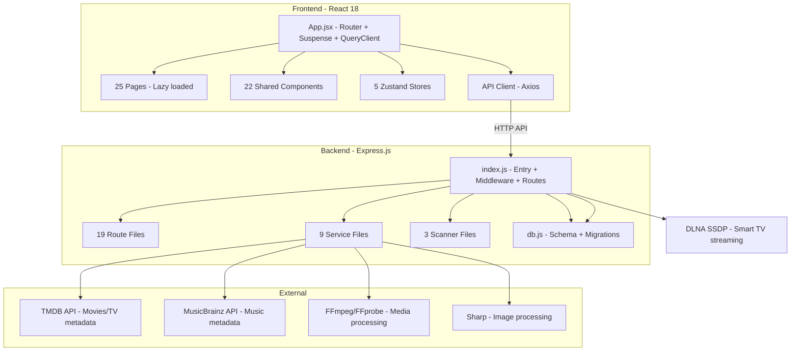

## نظرة عامة على المنتج

ARN Stream هو منصة بث وإدارة وسائط متكاملة تعمل محلياً (بديل شخصي لـ Netflix و Spotify)، طورها عبده رجب نصار (ARN Technology). يعمل على المنفذ 8096 ويدعم الأفلام والمسلسلات والموسيقى مع DLNA للشاشات الذكية.

## الميزات الأساسية

- بث أفلام ومسلسلات مع مشغل فيديو متقدم (FFmpeg transcoding)
- مكتبة موسيقى كاملة (فنانون/ألبومات/مسارات/قوائم تشغيل)
- بحث تنبؤي ذكي مع تطبيع النص العربي وترتيب بالصلة
- دعم RTL كامل و i18n (عربي/إنجليزي)
- DLNA/UPnP للبث على الشاشات الذكية و VLC
- لوحة تحكم إدارية (إحصائيات/قاعدة بيانات/مستخدمون/إعدادات)
- نظام مصادقة RBAC (admin/user) مع JWT و bcrypt
- مكون CosmicBackground بخلفية كونية متحركة (نجوم/سدم/شهب)
- تطبيق Python tray launcher للنظام (PyQt6 + PyInstaller)

## التقنيات المستخدمة

- **Frontend**: React 18 + Vite 5 + TailwindCSS 3 + Framer Motion + React Query 5 + Zustand + i18next + Lucide Icons
- **Backend**: Express.js 4 + Node.js (ESM modules) + better-sqlite3 + sharp + fluent-ffmpeg
- **Database**: better-sqlite3 (WAL mode) مع 13 جدول + migrations تدريجية
- **Media Processing**: ffprobe + ffmpeg + sharp (WebP + LRU cache)
- **DLNA**: UPnP/SSDP مخصص للبث
- **Launcher**: Python PyQt6 (PyInstaller)
- **Build**: Vite (frontend) + Inno Setup (installer)

## البنية المعمارية

## تدفق البيانات

- **Frontend**: App.jsx يستخدم lazy loading لـ 25 صفحة → API client (Axios) → Backend API
- **Backend**: Express middleware (CORS, headers, auth) → 19 route files → 9 services → better-sqlite3
- **Search**: `/api/search` يستخدم `norm_ar()` SQL function لتطبيع عربي → LIKE queries على 4 جداول
- **Image pipeline**: source file → sharp (WebP + attention cropping) → disk cache + LRU memory cache
- **Streaming**: `/api/stream` → FFmpeg transcoding → HTTP range response

## نقاط القوة المؤكدة

1. **بنية نظيفة**: فصل واضح routes/services/scanner + ESM modules
2. **Code splitting**: جميع 25 صفحة lazy loaded في `App.jsx`
3. **أمان أساسي**: JWT + bcrypt + rate limiting على login + OWASP headers
4. **مرونة قاعدة البيانات**: 30+ migration statements مع try/catch + WAL mode
5. **LRU cache ذكي**: fallback مدمج عند غياب `lru-cache` في `image-cache.js`
6. **إدارة موارد**: graceful shutdown يوقف FFmpeg + DLNA + DB بشكل نظيف
7. **CosmicBackground**: مكون مرن بـ density/variant/showShootingStar props

## المشكلات المحددة (غير المُصلحة بعد)

1. **N+1 query في `/api/search`** (الأسطر 245-354 من `index.js`): كل نتيجة بحث تنفذ 2-3 استعلامات منفصلة لجلب الصورة → من N+1 إلى استعلام JOIN واحد
2. **عدم وجود HTTP Compression**: `compression` مثبت في `package.json` لكن غير مستخدم في `index.js`
3. **عدم وجود response cache**: `node-cache` مثبت لكن middleware غير مُنشأ
4. **Static assets**: `express.static` على السطر 482 بدون `maxAge` أو `immutable`
5. **فهارس مفقودة**: `movies.title`, `series.title`, `tracks.title`, `artists.name`, `added_at` DESC — مهمة لـ LIKE queries والترتيب
6. **React Query**: `staleTime: 30000` قصير جداً (30 ثانية) للبيانات التي تتغير نادراً (landing/movies-home)
7. **Request logging**: `[API] ${req.method} ${req.url}` لكل طلب بما فيها الصور = ضغط على console

## ملاحظات التنفيذ

- **الأمان**: rate limiting موجود فقط على `/auth/login` (in-memory Map) — يحتاج توسعة لـ `/api/scan` و `/api/database/*`
- **الأداء**: `compression` + `node-cache` مثبتتان بالفعل في `server/package.json` — يحتاج فقط wiring في `index.js`
- **الصور**: `image-cache.js` يستخدم بالفعل WebP + position:'attention' + LRU cache — مكتمل
- **Frontend**: `App.jsx` يستخدم lazy loading بالفعل لكل الصفحات — لا يحتاج code splitting إضافي
- **Blast radius**: جميع التحسينات مقترحة كـ middleware جديد لا يلمس الـ routes الموجودة

## ملحقات الوكيل

### SubAgent

- **code-explorer**: استكشاف متعمق للكود عند الحاجة لتحديد استعلامات N+1 بدقة في routes إضافية خارج `/api/search`، وتحديد ما إذا كانت هناك endpoints أخرى تعاني من نفس النمط. النتيجة المتوقعة: قائمة كاملة بـ N+1 hotspots في الـ server.