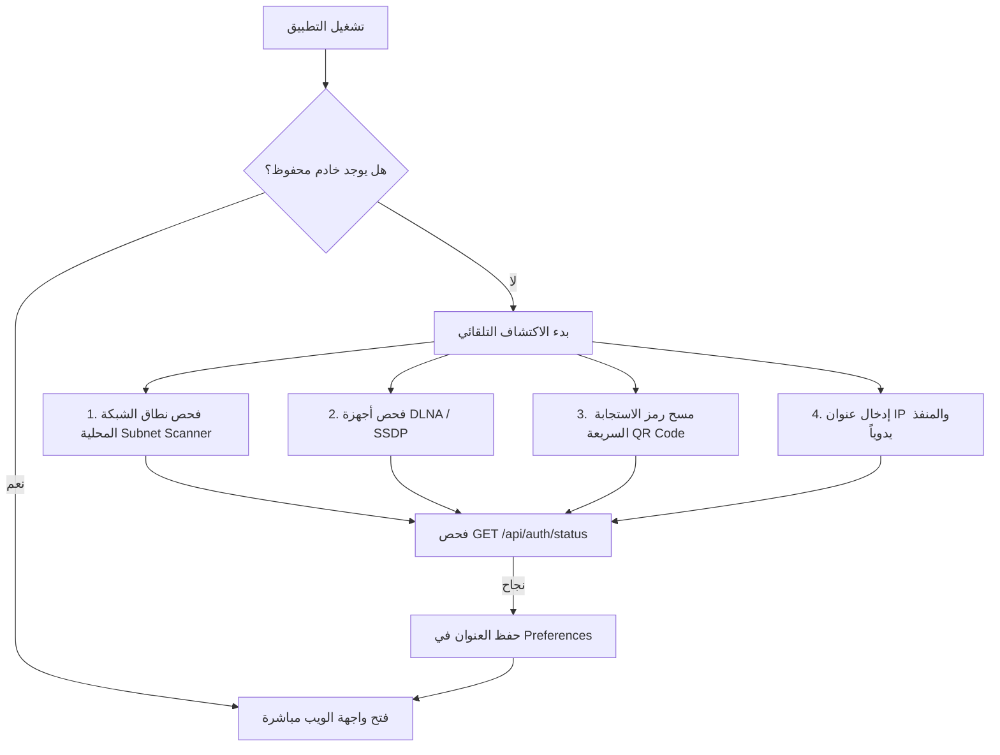

# 📱 المخطط المعماري الشامل لبناء تطبيق أندرويد الهجين لمنصة ARN Stream
### الدليل الهندسي الكامل ومفاتيح الـ API الموجه لـ Google AI Studio لبناء عميل أندرويد فائق الأداء
> **المنصة والخادم:** ARN Stream Media Server  
> **الشركة المالكة:** ARN Technology  
> **تطوير وبرمجة:** عبده رجب نصار (Abdou Ragab Nassar)  
> **حقوق الملكية الفكرية:** حقوق النشر (c) 2026 لشركة ARN Technology. جميع الحقوق محفوظة.  
> **الغرض:** تغذية هذه الوثيقة مباشرة إلى **Google AI Studio** أو بيئات الذكاء الاصطناعي لتوليد المشروع خطوة بخطوة وبدون أي نقص.

---

## 📑 فهرس المحتويات
1. [نظرة عامة وفلسفة المعمارية الهجينة (Hybrid Architecture)](#1-نظرة-عامة-وفلسفة-المعمارية-الهجينة)
2. [دليل مسارات الـ API والربط بين التطبيق والخادم (API Reference)](#2-دليل-مسارات-الـ-api-والربط-بين-التطبيق-والخادم)
3. [نظام الاكتشاف التلقائي والربط الذكي (Server Auto-Discovery & Pairing)](#3-نظام-الاكتشاف-التلقائي-والربط-الذكي)
4. [معمارية حاوية الويب المتقدمة (Supercharged Android WebView)](#4-معمارية-حاوية-الويب-المتقدمة)
5. [شاشات واجهة المستخدم (UI/UX Flow & Screens)](#5-شاشات-واجهة-المستخدم)
6. [الهيكل الكامل لملفات المشروع البرمجي (Source Code Reference)](#6-الهيكل-الكامل-لملفات-المشروع-البرمجي)
7. [برومبت التوليد المباشر لـ Google AI Studio (System Prompt)](#7-برومبت-التوليد-المباشر-لـ-google-ai-studio)

---

## 🚀 1. نظرة عامة وفلسفة المعمارية الهجينة

### 1.1 لماذا هذا التصميم هو الأفضل لمنصة ARN Stream؟
بدلاً من إعادة برمجة كل شاشة (أفلام، مسلسلات، صوتيات، قرآن، وبث مباشر) في أندرويد بشكل منفصل، يعتمد التطبيق على معمارية **الهيكل الأصيل الذكي (Smart Native Shell) + حاوية الويب فائقة الأداء (Supercharged WebView)**، وهي نفس الطريقة المتبعة في تطبيقات عالمية رائدة مثل Plex و Jellyfin:
* **تحديث فوري:** أي ميزة أو تحسين في واجهة الويب يظهر فوراً في تطبيق الأندرويد دون الحاجة لإعادة بناء وتثبيت ملف APK.
* **استقرار مشغلات الميديا:** الاستفادة الكاملة من كود تشغيل الفيديو والصوتيات، ونظام الترجمة، والـ HLS Streaming، والريموت كنترول المبرمج في كلينت الويب.
* **تجربة أصيلة 100% (True Native Feel):** يبدأ التطبيق بشاشة Splash فاخرة مع شعار 3D نابض، ثم شاشة اكتشاف تلقائي للشبكة المحلية ومسح QR Code، وعند الانتقال للويب، يتم تفعيل التسريع العتادي، ودعم تكبير الفيديو لملء الشاشة، والتحكم بزر الرجوع الفيزيائي.

---

## 📡 2. دليل مسارات الـ API والربط بين التطبيق والخادم

يعمل خادم **ARN Stream** كخادم وسائط مدمج مبني بـ Node.js / Express على المنفذ الافتراضي **`8096`**، ويدعم بروتوكولات HTTP و WebSocket.

### 2.1 حالة الخادم وفحص الاتصال (Server Status & Discovery)
* **المسار:** `GET /api/auth/status`
* **الهدف:** فحص جاهزية الخادم وحالة التهيئة وما إذا كان هناك مستخدم مسجل.
* **شكل الاستجابة (JSON):**
```json
{
  "data": {
    "initialized": true,
    "authenticated": false,
    "user": null,
    "hasLibraries": true
  }
}
```

---

### 2.2 جلب البروفايلات والحسابات العامة (Public Profiles)
* **المسار:** `GET /api/auth/public-users`
* **الهدف:** عرض أسماء المستخدمين والصور الرمزية في شاشة تسجيل الدخول لاختيار البروفايل (مثل نيتفلكس).
* **شكل الاستجابة (JSON):**
```json
{
  "success": true,
  "data": [
    {
      "id": 1,
      "username": "admin",
      "display_name": "عبده رجب نصار",
      "avatar": "/avatars/avatar_1.png"
    }
  ]
}
```

---

### 2.3 تسجيل الدخول والمصادقة (Authentication Login)
* **المسار:** `POST /api/auth/login`
* **الترويسات:** `Content-Type: application/json`
* **البيانات المرسلة (Body):**
```json
{
  "username": "admin",
  "password": "1234"
}
```
* **شكل الاستجابة:**
```json
{
  "success": true,
  "data": {
    "token": "eyJhbGciOiJIUzI1NiIsInR5cCI6IkpXVCJ9...",
    "user": {
      "id": 1,
      "username": "admin",
      "display_name": "عبده رجب نصار",
      "role": "admin"
    }
  }
}
```

---

### 2.4 استعلام المكتبات (Media Libraries)
* **المسار:** `GET /api/libraries?non_empty=true`
* **شكل الاستجابة:**
```json
{
  "success": true,
  "data": [
    { "id": 1, "name": "أفلام", "type": "movies", "movies_count": 150 },
    { "id": 2, "name": "مسلسلات", "type": "shows", "shows_count": 45 },
    { "id": 3, "name": "القرآن الكريم", "type": "quran", "tracks_count": 114 },
    { "id": 4, "name": "بث مباشر", "type": "live", "channels_count": 30 }
  ]
}
```

---

### 2.5 الريموت كنترول والمزامنة اللحظية (WebSocket Handoff)
* **البروتوكول:** `ws://<SERVER_IP>:8096/api/handoff/ws`
* **الهدف:** ربط تطبيق الهاتف بكود الويب على التلفزيون أو الكمبيوتر للتحكم بتشغيل وإيقاف الفيديو وتمرير الأوامر اللحظية.

---

## 🔍 3. نظام الاكتشاف التلقائي والربط الذكي (Server Discovery)

يتيح التطبيق للمستخدم الاتصال بالخادم بـ 3 طرق تلقائية وسريعة:



---

## 🌐 4. معمارية حاوية الويب المتقدمة (Supercharged Android WebView)

لضمان تحويل صفحة الويب إلى تطبيق أصيل متكامل، يحتوي كود `WebClientScreen.kt` على الخصائص التالية:

1. **دعم تشغيل الفيديو بملء الشاشة (True Fullscreen HTML5 Video):**
   * ربط `WebChromeClient.onShowCustomView` و `onHideCustomView`.
   * تدوير الشاشة تلقائياً للوضع الأفقي `SCREEN_ORIENTATION_SENSOR_LANDSCAPE` عند الضغط على زر ملء الشاشة داخل مشغل الفيديو.
   * إخفاء شريط الإشعارات وشريط التنقل السفلي (Immersive Mode).
   * تفعيل `FLAG_KEEP_SCREEN_ON` لمنع انطفاء الشاشة أثناء مشاهدة المحتوى.
2. **التحكم الذكي بزر الرجوع في الهاتف (Hardware Back Button):**
   * عند تكبير الفيديو: الضغط على الرجوع يخرج من وضع ملء الشاشة فقط.
   * عند تصفح المنصة: الضغط على الرجوع يعود للصفحة السابقة داخل الموقع (`webView.canGoBack()`).
   * عند الوصول للصفحة الرئيسية: إظهار نافذة تأكيد خروج ذكية تحتوي على زر "إغلاق التطبيق" وزر "تغيير الخادم".
3. **التسريع العتادي وتخزين الجلسات:**
   * تفعيل `View.LAYER_TYPE_HARDWARE` للحصول على 60 إطار في الثانية ونعومة تامة.
   * تفعيل `domStorageEnabled = true` و `databaseEnabled = true` لحفظ جلسة الدخول وبيانات التخزين المحلي (LocalStorage).
   * تفعيل الكوكيز والـ Third-Party Cookies.
   * إلغاء قيود تشغيل الميديا `mediaPlaybackRequiresUserGesture = false`.

---

## 📱 5. شاشات واجهة المستخدم (UI Flow & Screens)

1. **شاشة البداية (SplashScreen):**
   * شعار ثلاثي الأبعاد خاص بـ ARN Stream مع توهج نيون نابض وألوان مستوحاة من الهوية الرسمية.
   * فحص سريع خلال ثانية واحدة لوجود خادم محفوظ، والتوجيه التلقائي.
2. **شاشة الاتصال والاكتشاف (ConnectScreen):**
   * واجهة زجاجية داكنة (Dark Glassmorphism) بنسبة 100% RTL.
   * فحص مستمر للشبكة، وعرض السيرفرات المتوفرة في بطاقات لمسية أنيقة.
   * زر فتح الكاميرا لمسح رمز QR.
   * حقل نصي أنيق لإدخال IP والمنفذ يدويًا مع زر اختبار الاتصال.
   * نافذة "حول التطبيق" الرسمية للمطور عبده رجب نصار وشركة ARN Technology.
3. **شاشة الويب (WebClientScreen):**
   * عرض منصة ARN Stream بكامل مميزاتها التفاعلية.
   * شريط تحميل ناعم بألوان الزمرد الأخضر أعلى الشاشة أثناء التنقل.
   * زر دائري عائم شفاف يفتح قائمة سريعة: "تحديث الصفحة"، "تغيير الخادم"، "حول التطبيق".
   * واجهة بديلة ذكية في حال انقطاع الشبكة تتيح إعادة المحاولة أو البحث عن خادم آخر بنقرة واحدة.

---

## 💻 6. الهيكل الكامل لملفات المشروع البرمجي

### 6.1 `android/app/build.gradle.kts`
```kotlin
plugins {
    alias(libs.plugins.android.application)
    alias(libs.plugins.kotlin.compose)
    alias(libs.plugins.secrets)
    alias(libs.plugins.google.services)
}

android {
    namespace = "com.example"
    compileSdk { version = release(36) { minorApiLevel = 1 } }

    defaultConfig {
        applicationId = "com.arntechnology.stream"
        minSdk = 24
        targetSdk = 34
        versionCode = 1
        versionName = "1.0.0"
        testInstrumentationRunner = "androidx.test.runner.AndroidJUnitRunner"
    }

    signingConfigs {
        create("release") {
            val ksFile = file("arn_technology_release.jks")
            storeFile = if (ksFile.exists()) ksFile else file("${rootDir}/arn_technology_release.jks")
            storePassword = "arn_stream_2026"
            keyAlias = "arn_technology"
            keyPassword = "arn_stream_2026"
            enableV1Signing = true
            enableV2Signing = true
            enableV3Signing = true
            enableV4Signing = true
        }
    }

    buildTypes {
        release {
            isCrunchPngs = false
            isMinifyEnabled = false
            proguardFiles(getDefaultProguardFile("proguard-android-optimize.txt"), "proguard-rules.pro")
            signingConfig = signingConfigs.getByName("release")
        }
        debug {
            signingConfig = signingConfigs.getByName("release")
        }
    }

    compileOptions {
        sourceCompatibility = JavaVersion.VERSION_11
        targetCompatibility = JavaVersion.VERSION_11
    }

    buildFeatures {
        compose = true
        buildConfig = true
    }
}
```

---

### 6.2 كود شاشة الويب المتطورة (`WebClientScreen.kt`)
```kotlin
package com.example.ui.screens.web

import android.annotation.SuppressLint
import android.app.Activity
import android.content.Context
import android.content.ContextWrapper
import android.content.Intent
import android.content.pm.ActivityInfo
import android.graphics.Bitmap
import android.net.Uri
import android.view.View
import android.view.ViewGroup
import android.view.WindowManager
import android.webkit.*
import android.widget.FrameLayout
import androidx.activity.compose.BackHandler
import androidx.activity.compose.rememberLauncherForActivityResult
import androidx.activity.result.contract.ActivityResultContracts
import androidx.compose.foundation.background
import androidx.compose.foundation.border
import androidx.compose.foundation.clickable
import androidx.compose.foundation.layout.*
import androidx.compose.foundation.shape.CircleShape
import androidx.compose.foundation.shape.RoundedCornerShape
import androidx.compose.material.icons.Icons
import androidx.compose.material.icons.filled.*
import androidx.compose.material.icons.outlined.*
import androidx.compose.material3.*
import androidx.compose.runtime.*
import androidx.compose.ui.Alignment
import androidx.compose.ui.Modifier
import androidx.compose.ui.draw.clip
import androidx.compose.ui.graphics.Color
import androidx.compose.ui.platform.LocalContext
import androidx.compose.ui.text.font.FontWeight
import androidx.compose.ui.text.style.TextAlign
import androidx.compose.ui.unit.dp
import androidx.compose.ui.unit.sp
import androidx.compose.ui.viewinterop.AndroidView
import androidx.core.view.WindowInsetsCompat
import androidx.core.view.WindowInsetsControllerCompat
import com.example.data.storage.PreferencesManager
import com.example.ui.components.ArnAboutDialog
import com.example.ui.theme.*
import kotlinx.coroutines.flow.firstOrNull

@SuppressLint("SetJavaScriptEnabled")
@Composable
fun WebClientScreen(
    preferencesManager: PreferencesManager,
    onSwitchServer: () -> Unit
) {
    val context = LocalContext.current
    val activity = remember(context) { 
        var ctx = context
        while (ctx is ContextWrapper) {
            if (ctx is Activity) break
            ctx = ctx.baseContext
        }
        ctx as? Activity
    }

    var targetUrl by remember { mutableStateOf<String?>(null) }
    var webViewInstance by remember { mutableStateOf<WebView?>(null) }
    var isPageLoading by remember { mutableStateOf(true) }
    var loadProgress by remember { mutableIntStateOf(0) }
    var connectionError by remember { mutableStateOf<String?>(null) }
    var showExitDialog by remember { mutableStateOf(false) }
    var showMenuSheet by remember { mutableStateOf(false) }
    var showAboutDialog by remember { mutableStateOf(false) }

    var isFullscreenVideo by remember { mutableStateOf(false) }
    var customVideoView by remember { mutableStateOf<View?>(null) }
    var customViewCallback by remember { mutableStateOf<WebChromeClient.CustomViewCallback?>(null) }

    LaunchedEffect(Unit) {
        val saved = preferencesManager.serverUrl.firstOrNull()
        if (!saved.isNullOrEmpty()) {
            val formatted = if (saved.startsWith("http://") || saved.startsWith("https://")) saved else "http://$saved"
            targetUrl = if (formatted.endsWith("/")) formatted else "$formatted/"
        } else {
            onSwitchServer()
        }
    }

    val exitFullscreenVideo: () -> Unit = {
        customViewCallback?.onCustomViewHidden()
        customViewCallback = null
        customVideoView = null
        isFullscreenVideo = false
        activity?.requestedOrientation = ActivityInfo.SCREEN_ORIENTATION_UNSPECIFIED
        activity?.window?.let { win ->
            win.clearFlags(WindowManager.LayoutParams.FLAG_KEEP_SCREEN_ON)
            WindowInsetsControllerCompat(win, win.decorView).show(WindowInsetsCompat.Type.systemBars())
        }
    }

    BackHandler {
        when {
            isFullscreenVideo -> exitFullscreenVideo()
            webViewInstance?.canGoBack() == true -> webViewInstance?.goBack()
            else -> showExitDialog = true
        }
    }

    Box(modifier = Modifier.fillMaxSize().background(ArnObsidian)) {
        if (targetUrl != null) {
            AndroidView(
                modifier = Modifier.fillMaxSize(),
                factory = { ctx ->
                    val rootContainer = FrameLayout(ctx).apply {
                        layoutParams = ViewGroup.LayoutParams(ViewGroup.LayoutParams.MATCH_PARENT, ViewGroup.LayoutParams.MATCH_PARENT)
                    }

                    val webView = WebView(ctx).apply {
                        layoutParams = ViewGroup.LayoutParams(ViewGroup.LayoutParams.MATCH_PARENT, ViewGroup.LayoutParams.MATCH_PARENT)
                        setLayerType(View.LAYER_TYPE_HARDWARE, null)
                        setBackgroundColor(0xFF090D16.toInt())

                        settings.apply {
                            javaScriptEnabled = true
                            domStorageEnabled = true
                            databaseEnabled = true
                            mediaPlaybackRequiresUserGesture = false
                            allowFileAccess = true
                            allowContentAccess = true
                            useWideViewPort = true
                            loadWithOverviewMode = true
                            cacheMode = WebSettings.LOAD_DEFAULT
                            mixedContentMode = WebSettings.MIXED_CONTENT_ALWAYS_ALLOW
                            userAgentString = "${settings.userAgentString} ARNStreamAndroidClient/1.0"
                        }

                        CookieManager.getInstance().apply {
                            setAcceptCookie(true)
                            setAcceptThirdPartyCookies(this@apply, true)
                        }

                        webViewClient = object : WebViewClient() {
                            override fun onPageStarted(view: WebView?, url: String?, favicon: Bitmap?) {
                                isPageLoading = true
                                connectionError = null
                            }
                            override fun onPageFinished(view: WebView?, url: String?) {
                                isPageLoading = false
                            }
                            override fun onReceivedError(view: WebView?, errorCode: Int, description: String?, failingUrl: String?) {
                                if (failingUrl == targetUrl || failingUrl?.startsWith(targetUrl.orEmpty()) == true) {
                                    connectionError = description ?: "تعذر الاتصال بالخادم"
                                }
                            }
                        }

                        webChromeClient = object : WebChromeClient() {
                            override fun onProgressChanged(view: WebView?, newProgress: Int) {
                                loadProgress = newProgress
                                if (newProgress >= 100) isPageLoading = false
                            }
                            override fun onShowCustomView(view: View?, callback: CustomViewCallback?) {
                                if (view == null) return
                                customVideoView = view
                                customViewCallback = callback
                                isFullscreenVideo = true
                                visibility = View.GONE
                                rootContainer.addView(view, FrameLayout.LayoutParams(ViewGroup.LayoutParams.MATCH_PARENT, ViewGroup.LayoutParams.MATCH_PARENT))
                                activity?.requestedOrientation = ActivityInfo.SCREEN_ORIENTATION_SENSOR_LANDSCAPE
                                activity?.window?.let { win ->
                                    win.addFlags(WindowManager.LayoutParams.FLAG_KEEP_SCREEN_ON)
                                    val insetsController = WindowInsetsControllerCompat(win, win.decorView)
                                    insetsController.hide(WindowInsetsCompat.Type.systemBars())
                                    insetsController.systemBarsBehavior = WindowInsetsControllerCompat.BEHAVIOR_SHOW_TRANSIENT_BARS_BY_SWIPE
                                }
                            }
                            override fun onHideCustomView() {
                                val view = customVideoView ?: return
                                rootContainer.removeView(view)
                                visibility = View.VISIBLE
                                exitFullscreenVideo()
                            }
                        }
                        loadUrl(targetUrl!!)
                    }
                    rootContainer.addView(webView)
                    webViewInstance = webView
                    rootContainer
                }
            )
        }

        // شريط التحميل العلوي
        if (isPageLoading && loadProgress in 1..99 && !isFullscreenVideo) {
            LinearProgressIndicator(
                progress = { loadProgress / 100f },
                modifier = Modifier.fillMaxWidth().align(Alignment.TopCenter).statusBarsPadding(),
                color = ArnEmeraldPrimary,
                trackColor = Color.Transparent
            )
        }

        // زر خيارات السيرفر العائم
        if (!isFullscreenVideo) {
            Box(modifier = Modifier.align(Alignment.TopEnd).statusBarsPadding().padding(top = 8.dp, end = 12.dp)) {
                IconButton(
                    onClick = { showMenuSheet = true },
                    modifier = Modifier.size(38.dp).clip(CircleShape).background(Color(0xCC0F172A)).border(1.dp, Color(0x33FFFFFF), CircleShape)
                ) {
                    Icon(Icons.Default.MoreVert, contentDescription = "خيارات", tint = Color.White, modifier = Modifier.size(20.dp))
                }
            }
        }
    }

    // نافذة الخروج وتبديل السيرفر
    if (showExitDialog) {
        AlertDialog(
            onDismissRequest = { showExitDialog = false },
            title = { Text("الخروج من ARN Stream", color = Color.White, fontWeight = FontWeight.Bold) },
            text = { Text("هل تريد إغلاق التطبيق أم تغيير الخادم والبحث عن خادم آخر؟", color = Color(0xFF94A3B8)) },
            containerColor = Color(0xFF0F172A),
            confirmButton = {
                TextButton(onClick = { showExitDialog = false; activity?.finish() }) {
                    Text("إغلاق التطبيق", color = Color(0xFFEF4444), fontWeight = FontWeight.Bold)
                }
            },
            dismissButton = {
                Row {
                    TextButton(onClick = { showExitDialog = false; onSwitchServer() }) {
                        Text("تغيير الخادم", color = ArnGoldAccent)
                    }
                    TextButton(onClick = { showExitDialog = false }) {
                        Text("إلغاء", color = Color(0xFF94A3B8))
                    }
                }
            }
        )
    }

    ArnAboutDialog(isOpen = showAboutDialog, onDismiss = { showAboutDialog = false })
}
```

---

## 🤖 7. برومبت التوليد المباشر لـ Google AI Studio

عند استخدام **Google AI Studio (Gemini 1.5 Pro / Flash)**، يمكنك نسخ البرومبت التالي لتوليد المشروع أو أي تعديلات إضافية:

```markdown
You are an expert Senior Android Architect building the official Android Client for "ARN Stream Media Server" by ARN Technology (Developer: Abdou Ragab Nassar).

Project Requirements:
1. Target Architecture: Hybrid Native Shell in Jetpack Compose + Supercharged Android WebView.
2. Initial Splash Screen: 3D logo with pulsing ambient glow. If serverUrl is saved in DataStore, navigate directly to "web"; otherwise navigate to "connect".
3. Auto-Discovery Screen (ConnectScreen):
   - Fast LAN Subnet Ping + SSDP multicast discovery for ARN Stream server on port 8096.
   - Camera QR scanner and manual IP/port entry fallback.
   - Verify server with GET /api/auth/status and save URL in PreferencesManager.
4. Supercharged WebView (WebClientScreen):
   - Fullscreen HTML5 video handling via WebChromeClient.onShowCustomView (sensor landscape lock, status bar hide, FLAG_KEEP_SCREEN_ON).
   - Android BackHandler to navigate web history or prompt exit dialog.
   - DomStorage, database, and hardware acceleration enabled.
   - Top action menu allowing page reload, server switching, and About Dialog.
5. Brand Identity: Dark Luxury Glassmorphism (#090D16, #0F172A), Arabic RTL layout, and official About ARN Technology credentials.
```
