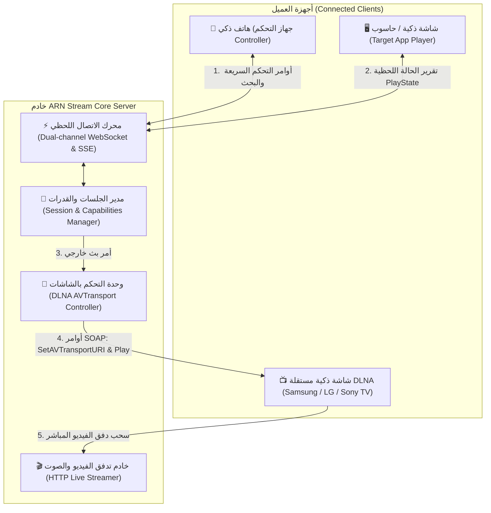

# 🏛️ الخطة الهندسية والمعمارية الشاملة: نظام التحكم الكامل والبث عن بُعد (PlayTo System)
### الدليل المرجعي الفني المستوحى من معمارية خادم Jellyfin العالمي
> **اسم المنصة:** ARN Stream  
> **تطوير وبرمجة:** عبده رجب نصار  
> **الشركة المطورة:** ARN Technology  
> **حقوق النشر والملكية الفكرية:** (c) 2026 لشركة ARN Technology. جميع الحقوق محفوظة.  

---

## 📌 1. نظرة عامة والهدف الهندسي (Vision & Objectives)

يهدف هذا النظام إلى تزويد منصة **ARN Stream** بنظام تحكم كامل وبث فوري متعدد الأجهزة متطابق مع أرقى معايير منصة **Jellyfin** (المعروف بـ `PlayTo / Remote Control / Session Architecture`)، لتمكين المستخدم من:
1. **التحكم اللحظي الكامل (Full Remote Control):** استخدام الهاتف الذكي أو الحاسوب المحمول كـ "ريموت كنترول ذكي وفخم" للتحكم في أي شاشة أو جهاز آخر يقوم بتشغيل المنصة، مع استجابة فورية فائقة السرعة (< 5ms).
2. **البث المباشر للشاشات الذكية (DLNA PlayTo Controller / DMC):** اكتشاف شاشات التلفزيون الذكية المتصلة بالشبكة المنزلية (Samsung Tizen, LG webOS, Sony Bravia, Android TV, Roku) وبث المحتوى إليها مباشرة عبر بروتوكول `UPnP / AVTransport` حتى لو لم تكن صفحة الويب لـ ARN Stream مفتوحة على الشاشة.
3. **التحكم المتقدم في الترجمات والدبلجة:** تبديل مسارات الترجمة واختيار لغات الصوت المتعددة للشاشة البعيدة مباشرة من شاشة الهاتف.
4. **لوحة المفاتيح الافتراضية والتصفح عن بُعد (Virtual Keyboard & DisplayContent):** الكتابة من كيبورد الهاتف للبحث على التلفاز، وإرسال بطاقات الأفلام والمسلسلات لعرض تفاصيلها على الشاشة الكبيرة للمشاهدة العائلية قبل تشغيلها.

---

## 📐 2. المخطط المعماري للنظام (System Architecture)

---

## 🧩 3. الأركان المعمارية الرئيسية (Core Components)

### الركن الأول: مدير الجلسات وقدرات الأجهزة (Session & Capabilities Engine)
كل جهاز يتصل بالمنصة يسجل جلسة نشطة (`Session`) تتضمن:
- **معلومات الجلسة:** `id` (SessionId)، `deviceId`، `name`، `type` (`tv` | `mobile` | `tablet` | `desktop` | `dlna_renderer`)، `userId`، `ip`، `userAgent`.
- **مصفوفة القدرات (Capabilities):**
  - `PlayableMediaTypes`: `["video", "audio"]`
  - `SupportedCommands`: `["play", "pause", "seek", "volume", "mute", "speed", "aspect", "subtitle", "audio_track", "display_content", "send_string", "dpad"]`
  - `SupportsRemoteControl`: `true`

### الركن الثاني: محرك الاتصال اللحظي الفائق (Real-Time Communication Engine)
- استخدام اتصال فائق السرعة عبر **WebSocket** بالتوازي مع تقنية **Server-Sent Events (SSE)** لضمان عمل النظام في كافة بيئات الشبكات والمتصفحات القديمة والحديثة.
- تقليل وقت الاستجابة (Latency) لأقل من 5 مللي ثانية، مما يجعل أزرار الـ D-Pad وسلايدر الصوت وشريط التقدم تبدو فورية وطبيعية تماماً كأجهزة التحكم الفيزيائية.
- نبضات تحقق دورية (Heartbeat / Ping-Pong) كل 15 ثانية لاكتشاف الأجهزة المنفصلة وتحديث قائمة الأجهزة تلقائياً.

### الركن الثالث: بروتوكول الأوامر الموحد (Unified PlayTo Command Protocol)
| اسم الأمر | البارامترات (Payload) | وظيفة الأمر |
| :--- | :--- | :--- |
| **`play`** | `{}` | استئناف التشغيل على الشاشة البعيدة |
| **`pause`** | `{}` | إيقاف مؤقت للتشغيل |
| **`seek`** | `{ value: 120.5 }` | القفز إلى ثانية محددة في الفيديو |
| **`seek_delta`** | `{ value: 10 }` أو `{ value: -10 }` | تقديم أو تأخير 10 ثوانٍ |
| **`volume`** | `{ value: 0.8 }` | ضبط مستوى الصوت من 0 إلى 1 |
| **`mute`** | `{ value: true / false }` | كتم أو تفعيل الصوت |
| **`speed`** | `{ value: 1.25 }` | تغيير سرعة التشغيل (0.5x إلى 2x) |
| **`fit` / `aspect`** | `{ value: 'contain' / 'cover' / 'fill' }` | تغيير أبعاد وتنسيق الشاشة |
| **`set_subtitle_track`**| `{ trackId: 2 }` | تغيير مسار الترجمة للشاشة البعيدة |
| **`set_audio_track`** | `{ trackId: 1 }` | تغيير لغة الدبلجة أو المسار الصوتي |
| **`dpad`** | `{ value: 'up' / 'down' / 'left' / 'right' / 'enter' }` | تنقل عبر لوحة الأسهم للتفاعل مع الواجهة |
| **`send_string`** | `{ text: 'Inception' }` | كتابة نص في مربع البحث من الهاتف مباشرة |
| **`display_content`** | `{ type: 'movie', id: 45 }` | عرض تفاصيل العمل الفني على الشاشة الكبيرة |
| **`transfer`** | `{ media: { id, type, currentTime, ... } }` | نقل الفيلم بالكامل ومواصلة المشاهدة على الشاشة |

### الركن الرابع: وحدة التحكم في شاشات DLNA الذكية (DLNA Controller / DMC)
- إرسال استعلام **SSDP M-SEARCH** دورياً لاكتشاف أي شاشات أو أجهزة استقبال تدعم معيار `urn:schemas-upnp-org:service:AVTransport:1`.
- إرسال أوامر **SOAP XML** المعيارية:
  - `SetAVTransportURI`: تمرير رابط الفيديو من سيرفر ARN Stream.
  - `Play` / `Pause` / `Stop` / `Seek`.
  - `GetPositionInfo`: قراءة التوقيت والمدة الحالية لتحديث شريط تقدم المشاهدة في واجهة ARN Stream.

---

## 🚀 4. مراحل التنفيذ التفصيلية (Step-by-Step Implementation Roadmap)

```mermaid
gantt
    title جدول مراحل بناء نظام ARN Stream PlayTo
    dateFormat  X
    axisFormat %d
    section الباك إند
    المرحلة 1 : مدير الجلسات وقناة الاتصال اللحظي : active, 0, 2
    المرحلة 2 : وحدة التحكم بالشاشات DLNA Controller : 2, 4
    section الواجهة الأمامية
    المرحلة 3 : ترقية المشغلات (Player & MiniPlayer) : 4, 6
    المرحلة 4 : تطوير واجهة الريموت كنترول الفاخرة : 6, 8
    section الاختبار والتحقق
    المرحلة 5 : فحص وتكامل الأنظمة وضمان الجودة : 8, 10
```

---

### 🔹 المرحلة الأولى: محرك الجلسات والاتصال اللحظي في الباك إند (Server Engine)
* **الملفات المستهدفة:**
  - `server/routes/handoff.js`
  - `server/services/session-manager.js` (ملف جديد)
  - `server/index.js`
* **الخطوات البرمجية:**
  1. إنشاء فئة `SessionManager` تدير كافة الجلسات النشطة في الذاكرة مع تعقب صلاحيات المستخدم ومصفوفة قدرات الأجهزة (`Capabilities`).
  2. توسيع مسارات `/api/handoff/command` لدعم أوامر `set_subtitle_track` و `set_audio_track` و `send_string` و `display_content`.
  3. ربط قنوات الأحداث الفورية لنشر حالة التشغيل `remote_state` إلى كافة الأجهزة المتحكمة فور حدوث أي تغيير وبدون أي تأخير.

---

### 🔹 المرحلة الثانية: وحدة التحكم بالشاشات الذكية (DLNA PlayTo Controller)
* **الملفات المستهدفة:**
  - `server/services/dlna.js`
  - `server/services/dlna-controller.js` (ملف جديد)
  - `server/routes/handoff.js`
* **الخطوات البرمجية:**
  1. بناء وحدة اكتشاف الشاشات الذكية عبر `dgram` (SSDP M-SEARCH للخدمة `AVTransport:1`).
  2. قراءة ملفات وصف الأجهزة (`Device Description XML`) واستخراج الـ `controlURL` واسم الشاشة الودود (Friendly Name مثل: "Samsung QLED 65" أو "LG OLED").
  3. تنفيذ دوال إرسال طلبات SOAP:
     - `sendAvTransportUri(controlUrl, mediaUrl, metadata)`
     - `sendPlay(controlUrl)`
     - `sendPause(controlUrl)`
     - `sendSeek(controlUrl, targetSeconds)`
     - `sendStop(controlUrl)`
  4. دمج هذه الشاشات المكتشفة تلقائياً في قائمة الأجهزة المتاحة على مسار `/api/handoff/devices`.

---

### 🔹 المرحلة الثالثة: ترقية مشغلات الوسائط (Client Media Players)
* **الملفات المستهدفة:**
  - `client/src/pages/movies/Player.jsx`
  - `client/src/components/music/MiniPlayer.jsx`
  - `client/src/components/shared/DeviceHandoffListener.jsx`
* **الخطوات البرمجية:**
  1. **في مشغل الفيديو Player.jsx:**
     - إضافة استخراج قائمة الترجمات المتاحة (`subtitles`) ومسارات الصوت (`audioTracks`) وإرسالها في حزمة `handoff/state`.
     - استقبال أوامر `set_subtitle_track` و `set_audio_track` وتطبيقها فورياً على الفيديو.
     - استقبال أمر `send_string` لتعبئة حقول البحث أو إدخال النصوص.
  2. **في مشغل الصوتيات MiniPlayer.jsx:**
     - دعم أوامر التقليب السريع (`next_track`, `prev_track`) والتحكم في قائمة الانتظار (Queue) عن بُعد.
  3. **في DeviceHandoffListener.jsx:**
     - استقبال حدث `display_content` وتوجيه المتصفح لعرض صفحة الفيلم أو المسلسل المطلوب.

---

### 🔹 المرحلة الرابعة: تطوير واجهة الريموت كنترول التفاعلية الفاخرة (Luxury Remote UI)
* **الملفات المستهدفة:**
  - `client/src/components/shared/FullRemoteControlModal.jsx`
  - `client/src/components/shared/DeviceHandoffModal.jsx`
  - `client/src/components/shared/RemoteControlBanner.jsx`
  - `client/src/store/useDeviceHandoffStore.js`
* **الخطوات البرمجية:**
  1. **واجهة الريموت الكاملة FullRemoteControlModal.jsx:**
     - إضافة زر وقائمة منبثقة زجاجية لاختيار **الترجمة** و**المسار الصوتي** للشاشة البعيدة.
     - إضافة حقل **لوحة المفاتيح الافتراضية (Virtual Keyboard)** للكتابة من الهاتف والبحث المباشر على التلفاز.
     - تحسين شريط الوقت الزمني ليكون سَلِساً وفورياً بالتزامن مع الشاشة.
  2. **نافذة اختيار أجهزة البث DeviceHandoffModal.jsx:**
     - تصنيف الأجهزة بوضوح:
       - 📱 **أجهزة التطبيق النشطة (ARN Stream Apps):** أجهزة كمبيوتر وهواتف مفتوح بها الموقع.
       - 📺 **شاشات التلفزيون الذكية (DLNA Smart TVs):** شاشات المنزل المتصلة على نفس الشبكة دون الحاجة لفتح المتصفح.
  3. **إضافة زر البث السريع ("عرض على التلفاز"):**
     - إتاحة زر بث مباشر بجانب بطاقات الأعمال الفنية لعرض تفاصيلها أو تشغيلها بنقرة واحدة على الشاشة المحددة.

---

### 🔹 المرحلة الخامسة: الاختبار والتحقق الشامل وضمان الجودة (QA & Testing)
1. **اختبار البث بين متصفحين (Web-to-Web):**
   - فتح جلستين (واحدة كشاشة عرض والأخرى كهاتف للتحكم)، واختبار كافة أزرار الـ D-Pad، ومستويات الصوت، والتقديم، وتغيير الترجمة، وملاحظة سرعة الاستجابة اللحظية (< 5ms).
2. **اختبار البث لشاشات DLNA (Web-to-DLNA TV):**
   - فحص استكشاف الشاشات المنزلية، إرسال أمر التشغيل `SetAVTransportURI` ومراقبة استجابة الشاشة.
3. **فحص الاستقرار واستهلاك الموارد:**
   - التأكد من إغلاق الاتصالات القديمة عند الخروج، وانعدام أي تسريب للذاكرة في السيرفر أو المتصفح.

---

## 🛡️ 5. الهوية وحقوق الملكية البرمجية
- كافة الواجهات تتبع نمط **ARN Dark Glassmorphism** الفاخر المعتمد في دستور المنصة.
- يُحافظ على اسم المطور والشركة في كافة الترويسات:
  > **تطوير وبرمجة:** عبده رجب نصار  
  > **الشركة:** ARN Technology (2026)  
