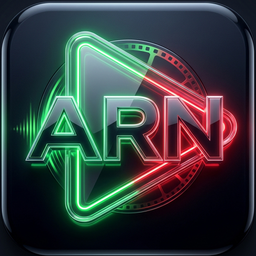

# 🎬 منصة ARN Stream المتكاملة (خادم وتطبيق بث الوسائط)
### ARN Stream — Ultimate Home & Enterprise Media Server & Streaming Ecosystem

<div align="center">



**الإصدار:** v2.0.2 • **المطور:** عبده رجب نصار • **الشركة:** ARN Technology  
**الهوية:** تصميم عصري فاخر (Dark Glassmorphic UI) مع أداء عالي وسرعة استجابة فائقة.

[](https://nodejs.org/)
[](https://react.dev/)
[](https://developer.android.com/jetpack/compose)
[](LICENSE)
[](build_and_sign.ps1)

</div>

---

## 🌟 نظرة عامة عن المنصة (Overview)

منصة **ARN Stream** هي منظومة وسائط ترفيهية متكاملة تجمع بين أفضل تجارب منصات البث العالمية (**Netflix** للأفلام والمسلسلات والمسرحيات والوثائقيات) و(**Spotify** للموسيقى والألبومات والتراكات) وقسم خاص للوسائط الروحية (**القرآن الكريم**)، مع معمارية Direct Play فائقة السرعة بدون استهلاك زائد لموارد المعالج وبدون الحاجة لمفاتيح API خارجية.

### ✨ الميزات الرئيسية (Core Features)

1. 🖥️ **سينما منزلية للأفلام والمسلسلات (Movies & Series):**
   - بث مباشر فوري (Direct Play) مع دعم استئناف التشغيل عبر `Range-Requests`.
   - معالجة الترجمات التلقائية (SRT/VTT) وتحويلها فورياً لـ WebVTT المتوافقة مع المتصفحات.
   - حفظ تقدم المشاهدة واستئناف التشغيل من نفس الثانية عبر كافة الأجهزة.

2. 🎵 **استوديو الموسيقى والقرآن الكريم (Music & Quran Studio):**
   - تصفح كامل للألبومات، الفنانين، القراء، والتراكات الصوتية.
   - **معادل صوت احترافي 10-Band Graphic Equalizer** مدمج في الواجهة مع أكثر من 15 نمطاً جاهزاً (Rock, Pop, Bass Boost, Vocal, Quran Clarity).
   - قوائم تشغيل مخصصة وقوائم ذكية (الأكثر استماعاً، المشغلة مؤخراً، المفضلة).

3. 📡 **بث القنوات التلفزيونية الحية (Live TV):**
   - قنوات رياضية وإخبارية وترفيهية مدمجة جاهزة للمشاهدة المباشرة بضغطة زر.

4. 🎮 **التحكم عن بُعد ونقل الجلسات (PlayTo & Device Handoff):**
   - رصد الأجهزة المتصلة على نفس الحساب في الوقت الفعلي.
   - نقل المشاهدة الفورية (Handoff) من الحاسوب إلى الهاتف أو العكس دون توقف.
   - ريموت كنترول تفاعلي كامل للتحكم في الشاشات وأجهزة البث عبر WebSockets و DLNA.

5. 🍿 **حفلات المشاهدة الجماعية المتزامنة (Watch Party):**
   - إنشاء غرف مشاهدة جماعية مع الأصدقاء برمز دخول آمن ومزامنة بالمللي ثانية عبر WebSockets مع شات نصي زجاجي تفاعلي.

6. 🔍 **محرك بحث تنبؤي ذكي (Smart Predictive Search):**
   - يدعم تطبيع اللغة العربية (`norm_ar`) ومعالجة التشكيل والهمزات وأل التعريف تلقائياً، مع ترتيب النتائج حسب الصلة.

---

## 🗂️ هيكل المجلدات والملفات (Project Architecture)

```
ARN-Stream/
├── docs/                      # 📚 التوثيق المحدث الشامل (المعمارية، الـ API، وتطبيق أندرويد)
│   ├── ARCHITECTURE.md        # المعمارية الهندسية الشاملة ومخطط قاعدة البيانات
│   ├── API_REFERENCE.md       # الدليل المرجعي الكامل لمسارات الـ REST API و WebSockets
│   └── ANDROID_CLIENT.md      # التوثيق الفني لتطبيق الهاتف الأصلي والهجين
├── client/                    # 🌐 واجهة الويب (React 18 + Vite + Tailwind CSS + Framer Motion)
│   ├── src/pages/             # شاشات الأفلام، المسلسلات، الموسيقى، والداشبورد
│   ├── src/components/        # المكونات الزجاجية الشفافة، المشغلات، والقوائم
│   ├── src/store/             # مخازن الحالات المركزية (Zustand)
│   └── src/utils/             # محرك معادل الصوت وحسابات الحركة
├── server/                    # 🚀 خادم الوسائط الخلفي (Node.js / Express / better-sqlite3)
│   ├── index.js               # نقطة الانطلاق ومسارات البث ومحرك WebSockets
│   ├── db.js                  # إدارة قاعدة البيانات والبحث والتطبيع العربي
│   ├── routes/                # مسارات الـ API المنفصلة
│   ├── services/              # خدمات كاش الصور، النسخ الاحتياطي، وإدارة الجلسات
│   └── scanner/               # محرك فحص المجلدات واستخراج الميتاداتا
├── android/                   # 📱 تطبيق الأندرويد الرسمي (Jetpack Compose + ExoPlayer + MLKit QR)
│   ├── app/src/main/          # شاشات Compose، ريموت الكنترول، ومحرك الاكتشاف التلقائي
│   └── build.gradle.kts       # إعدادات البناء والتوقيع الرقمي
├── launcher/                  # 🖥️ مشغل شريط المهام لسطح المكتب (PyQt6 System Tray)
│   ├── tray_app.py            # تطبيق صينية النظام مع قفل النسخة الواحدة
│   └── assets/                # أيقونات وخطوط المشغل
├── backups/                   # 💾 قوالب قواعد البيانات النظيفة (clean_media.db)
├── cert/                      # 🔐 شهادات التوثيق الرقمي لـ ARN Technology
├── installer.iss              # 📦 ملف بناء حزمة التثبيت Inno Setup 7
├── build_and_sign.ps1         # ⚡ سكريبت البناء والتوقيع الرقمي المعتمد RFC-3161
└── package.json               # إدارة وتشغيل المشروع
```

---

## 📚 وثائق المشروع المتخصصة (Documentation)

للاطلاع على الشروحات الفنية الدقيقة والمحدثة، يرجى مراجعة مجلد [docs/](file:///e:/مشاريعي/ARN-Stream/docs):
- [المعمارية الهندسية للنظام ومخطط البيانات (ARCHITECTURE.md)](file:///e:/مشاريعي/ARN-Stream/docs/ARCHITECTURE.md)
- [الدليل المرجعي للـ API و WebSockets و DLNA (API_REFERENCE.md)](file:///e:/مشاريعي/ARN-Stream/docs/API_REFERENCE.md)
- [دليل تطبيق أندرويد الأصلي والهجين (ANDROID_CLIENT.md)](file:///e:/مشاريعي/ARN-Stream/docs/ANDROID_CLIENT.md)

---

## 🚀 التشغيل السريع لبيئة التطوير (Quick Start)

### 1. تثبيت الحزم (مرة واحدة):
```bash
npm run install:all
```

### 2. تشغيل بيئة التطوير (Server + Frontend):
* **عبر PowerShell (موصى به لتفادي تعارض المنافذ):**
  ```powershell
  .\run_dev.ps1
  ```
* **أو عبر السكربت السريع:**
  ```cmd
  run_dev.bat
  ```
* **الروابط النشطة:**
  - واجهة الويب: `http://localhost:5173`
  - خادم الباك إند: `http://localhost:8096`

---

## 📦 التجميع والبناء للإنتاج (Production Build & Digital Signing)

لتوليد حزمة التثبيت المعتمدة والموقعة رقمياً بخاتم شركة ARN Technology وخوادم الطابع الزمني المعتمدة DigiCert RFC-3161 لتخطي تحذيرات Windows SmartScreen:

```powershell
.\build_and_sign.ps1
```

ينتج عن السكربت:
1. توليد حزمة التثبيت الذاتية في `dist/setup/ARN_Stream_Setup_v2.0.2.exe`.
2. حزمة ZIP مضغوطة قابلة للتوزيع المباشر.
3. مزامنة تلقائية للإصدار في مسار الإصدارات: `E:\اصداراتي`.

---

## 👤 بيانات التواصل والدعم الفني (Developer & Support)

* **المطور:** عبده رجب نصار (Abdou Ragab Nassar)
* **الشركة:** ARN Technology
* **WhatsApp:** [+201556710314](https://wa.me/201556710314)
* **Telegram:** [@ABDOURNASSAR95](https://t.me/ABDOURNASSAR95)
* **Facebook:** [abdouragab.nassar](https://www.facebook.com/abdouragab.nassar)
* **Messenger:** [abdouragab.nassar](https://m.me/abdouragab.nassar)

---

<div align="center">
حقوق النشر (c) 2026 لشركة ARN Technology. جميع الحقوق محفوظة.
</div>
