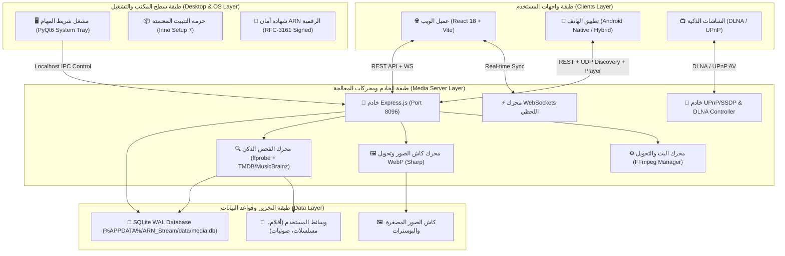

# 🏛️ المعمارية الهندسية لمنصة ARN Stream
### ARN Stream Platform — System Architecture & Technical Specifications

> **الشركة:** ARN Technology  
> **تطوير وبرمجة:** عبده رجب نصار  
> **حقوق الملكية والنشر:** جميع الحقوق محفوظة (c) 2026 لشركة ARN Technology  
> **الإصدار الحالي للمنصة:** v2.0.2  

---

## 🌟 1. نظرة عامة ورؤية المنظومة (System Overview)

منصة **ARN Stream** هي منظومة ترفيهية متكاملة لإدارة وبث الوسائط محلياً وشبكياً، صُممت لتكون بديلاً منزلياً ومؤسسياً متفوقاً يجمع بين مميزات منصات البث العالمية الكبرى:
- **سينما منزلية متكاملة (Movies & Series):** تجربة مستوحاة من Netflix و Jellyfin مع دعم Direct Play و Transcoding الذكي للترجمة والفيديو عبر FFmpeg.
- **منصة صوتية احترافية (Music & Audio):** تجربة موسيقية راقية مستوحاة من Spotify مع ألبومات، فنانين، قوائم تشغيل ذكية، ومحرك معادل صوت متطور (10-Band Equalizer Engine).
- **محتوى ديني وروحاني (Holy Quran & Spiritual Media):** قسم مخصص لتلاوات القرآن الكريم بأصوات مشاهير القراء مع تصنيف كامل للسور والأجزاء.
- **بث القنوات التلفزيونية الحية (Live TV):** تشغيل البث المباشر لقنوات الأخبار والرياضة والترفيه.
- **تحكم لحظي وبث ذكي عن بُعد (PlayTo & Device Handoff):** بث فوري والتحكم عن بعد في الأجهزة المتصلة والشاشات الذكية (DLNA/UPnP) ونظام المشاهدة الجماعية المتزامنة (Watch Party).

---

## 🏗️ 2. الهيكل العام والمكونات الرئيسية (High-Level Architecture)

تتكون منظومة **ARN Stream** من 4 طبقات رئيسية متناسقة:



---

## 💻 3. الحزمة التقنية (Tech Stack)

### 3.1 الخادم الخلفي (Backend Server)
- **البيئة:** Node.js (v18+ LTS / ESM Native).
- **إطار العمل:** Express.js 4 مع ضغط الردود `compression` والتخزين المؤقت في الذاكرة `node-cache` و `lru-cache`.
- **قاعدة البيانات:** `better-sqlite3` بنمط WAL (Write-Ahead Logging) وأداء فائق مع استعلامات مفهرسة وتطبيع لغوي للغة العربية `norm_ar`.
- **محركات الوسائط:**
  - `fluent-ffmpeg` مدمج مع `@ffmpeg-installer/ffmpeg` و `@ffprobe-installer/ffprobe` لاستخراج بيانات التراكات والترجمات بدقة.
  - `sharp` لضغط وتحويل البوسترات والخلفيات تلقائياً إلى صيغة `WebP` خفيفة وسريعة التحميل.
  - `music-metadata` لقراءة وسوم الـ ID3 وملفات الصوت المتقدمة (FLAC, MP3, AAC, OGG).
- **الاتصال اللحظي:** `ws` (WebSockets) لإدارة جلسات المشاهدة والتحكم عن بعد (PlayTo) والمشاهدة الجماعية (Watch Party).
- **بروتوكولات البث التلفزيوني والشاشات:** UPnP/SSDP محلي مع دعم DLNA Media Server و DLNA Media Controller (DMC).

### 3.2 الواجهة الأمامية (Web Frontend Client)
- **الأساس:** React 18 مع Vite 5 لسرعة البناء وإعادة التحميل الفوري (HMR).
- **التصميم والهوية:** Tailwind CSS 3 بنمط الزجاج المعتم الفاخر (**Dark Glassmorphism**) مع ألوان كبسولية متكيفة ومتحركة.
- **الحركات والتأثيرات:** Framer Motion للمؤثرات الانتقالية الناعمة والخلفيات الكونية المتحركة.
- **إدارة الحالة:** Zustand لإدارة الحالات المركزية (المصادقة، المشغل، جلسات البث، معادل الصوت، الإعدادات).
- **التخزين المؤقت والبيانات:** TanStack React Query v5 مع سياسات Cache-first و Invalidation التلقائي.
- **الترجمة واللغات:** `i18next` مع دعم كامل للغة العربية (RTL) والإنجليزية (LTR).
- **محرك الصوت المتقدم:** Web Audio API مع فلتر صوتي متكامل 10-Band Graphic Equalizer مع أكثر من 15 نمطاً جاهزاً (Rock, Pop, Bass Boost, Vocal, etc.).

### 3.3 مشغل سطح المكتب وحزمة الويندوز (Desktop Launcher & Packaging)
- **المشغل:** تطبيق مكتبي بلغة Python و PyQt6 يستقر في شريط المهام (System Tray).
- **منع التكرار (Single-Instance):** آلية `QLocalServer` لإظهار النافذة الحالية وإلغاء النسخ المكررة.
- **التثبيت:** حزمة Inno Setup 7 ثنائية اللغة (عربي/إنجليزي) تدمج بيئة Node.js المحمولة وتزرع شهادات الأمان تلقائياً.
- **الأمان والتوقيع الرقمي:** موقعة رقمياً بشهادة معتمدة من ARN Technology مع خادم طابع زمني RFC-3161 (DigiCert / Sectigo) لتخطي حظر **Windows 11 Smart App Control** و SmartScreen.

### 3.4 تطبيق الهاتف (Android Client)
- **اللغة:** Kotlin مع Android Jetpack Compose و Material 3.
- **المشغل الداخلي:** ExoPlayer (Jetpack Media3) للبث الصوتي والمرئي عالي الجودة.
- **الاتصال والاكتشاف:**
  - اكتشاف تلقائي للخوادم عبر حزم UDP Broadcast على الشبكة المحلية.
  - قارئ QR Code عبر Google MLKit Barcode Scanning للربط السريع بمسح الكود من الشاشة.
  - وضع هجين مدعوم بـ WebView متقدم يوفر تجربة الويب الكاملة بتناغم تام.

---

## 🗄️ 4. مخطط قاعدة البيانات ومسارات التخزين (Database & Storage)

### 4.1 موقع قاعدة البيانات
تبعاً لأفضل معايير أنظمة التشغيل وحماية بيانات المستخدم عند التحديث، يتم تخزين قاعدة البيانات والبيانات القابلة للكتابة في مسار النظام الآمن:
```
%APPDATA%/ARN_Stream/data/media.db
```
ويتم حمايتها بنسخ احتياطية تلقائية دورية في مجلد `backups/`.

### 4.2 الجداول الأساسية (Database Schema)
تحتوي قاعدة البيانات على الجداول التالية مع فهارس (Indexes) سريعة:
1. `users`: إدارة المستخدمين، كلمات المرور المشفرة (Bcrypt)، الأدوار (admin/user)، والصور الشخصية.
2. `libraries`: مجلدات الوسائط المضافة (أفلام، مسلسلات، موسيقى، قرآن).
3. `movies`: بيانات الأفلام، سنة الإنتاج، التقييم، الوصف، والمسار الفيزيائي.
4. `series`: بيانات المسلسلات، المواسم، وسنوات الإنتاج.
5. `episodes`: الحلقات، أرقام المواسم والحلقات، والمسارات.
6. `artists`: الفنانون والشيوخ والمنشدون مع النبذة التعريفية.
7. `albums`: الألبومات وسنوات الصدور وصور الأغلفة.
8. `tracks`: المسارات الصوتية، مدتها، جودتها، وترتيبها داخل الألبوم.
9. `images`: سجل كاش الصور (بوسترات، خلفيات، صور مصغرة) مع دمج WebP.
10. `playback_progress`: حفظ نقطة التوقف لكل مستخدم لاستئناف المشاهدة من نفس الثانية.
11. `playlists` & `playlist_items`: قوائم التشغيل المخصصة والذكية للمستخدمين.
12. `ratings`: تقييمات النجوم (1-10) ومفضلات المستخدم.
13. `tags` & `media_tags`: التصنيفات والوسوم المخصصة.

---

## ⚡ 5. الميزات والأنظمة المتطورة (Advanced Systems)

### 5.1 محرك البحث التنبؤي الذكي (Predictive Search & Arabic Normalization)
- تطبيع النص العربي (`norm_ar`): إزالة التشكيل، توحيد الهمزات (أ، إ، آ -> ا)، والتاء المربوطة (ة -> ه)، والياء (ى -> ي).
- معالجة أل التعريف (ال) تلقائياً سواء كتبها المستخدم أم لا.
- ترتيب النتائج ذكياً (Ranked Relevance) بالاعتماد على التطابق في البداية أولاً، وتوفر البوستر، ونوع الوسائط.

### 5.2 نظام التحكم عن بعد ونقل الجلسات (PlayTo & Device Handoff)
- رصد كافة الأجهزة المتصلة على نفس الحساب في الوقت الفعلي.
- إمكانية نقل المشاهدة بضغطة زر (Handoff) من الحاسوب إلى الهاتف أو التلفاز مع الحفاظ على موضع التشغيل بالثانية.
- لوحة تحكم كاملة عن بُعد (Play, Pause, Seek, Volume, Next, Subtitles).

### 5.3 نظام الحفلات والمشاهدة الجماعية (Watch Party)
- إنشاء غرف مشاهدة برمز PIN أو دعوة مباشرة.
- مزامنة دقيقة للإطارات بين جميع المشاركين عبر WebSockets.
- شات نصي زجاجي تفاعلي وقائمة الحاضرين في الوقت الفعلي.

---

## 🚀 6. خط أنابيب البناء والتوزيع (Build Pipeline)

يتم بناء المنظومة وتوقيعها رقمياً باستخدام السكربت الاحترافي [build_and_sign.ps1](file:///e:/مشاريعي/ARN-Stream/build_and_sign.ps1):
1. **تنظيف البيئة:** تنظيف كافة المجلدات المؤقتة (`build`, `dist`, `__pycache__`).
2. **قالب قاعدة البيانات:** توليد نسخة نظيفة خالية من بيانات المطور [backups/clean_media.db](file:///e:/مشاريعي/ARN-Stream/backups/clean_media.db).
3. **بناء الواجهة:** تشغيل `vite build` لتوليد ملفات الإنتاج في `client/dist`.
4. **تجميع المشغل:** تجميع مشغل بايثون عبر PyInstaller.
5. **التوقيع الرقمي:** توقيع الملف التنفيذي بخاتم رقمي معتمد وطابع زمني RFC-3161 عبر خوادم DigiCert.
6. **إنشاء الحزمة:** تجميع حزمة التثبيت Inno Setup فائقة الضغط LZMA2-Ultra.
7. **إزالة قيود الويندوز:** تشغيل `Unblock-File` لحماية الملف من عزل Zone.Identifier.
